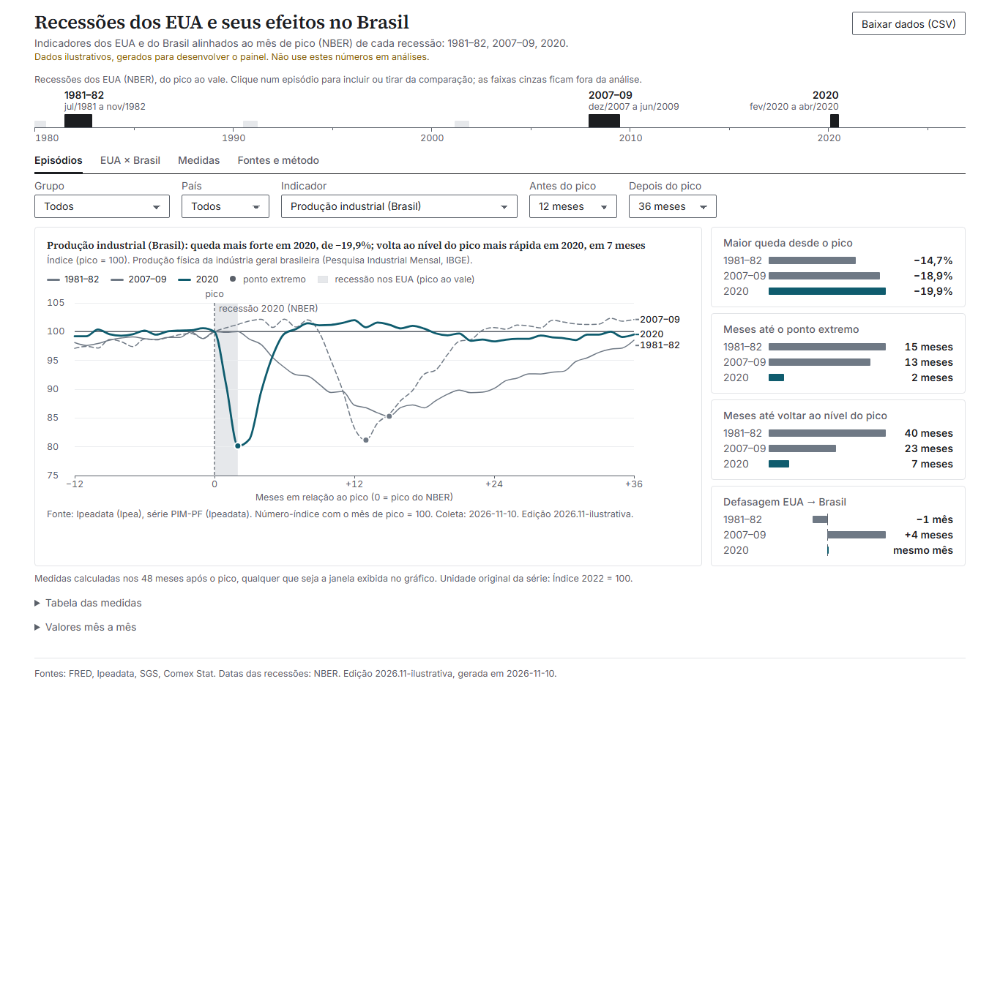
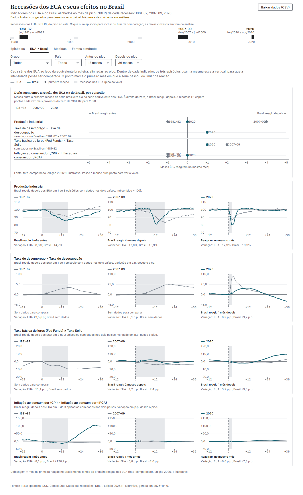
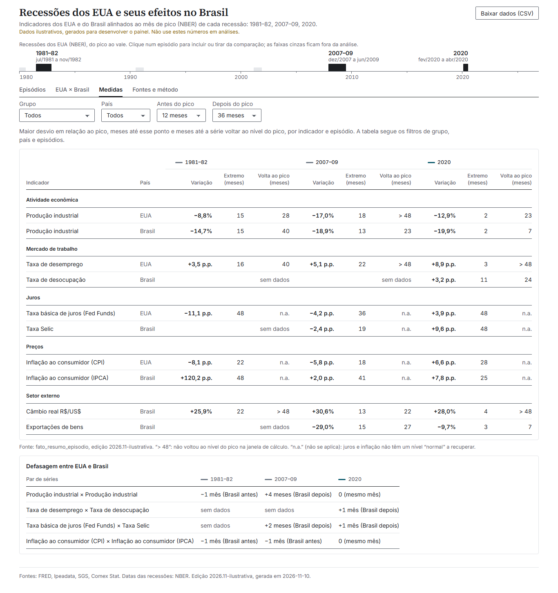
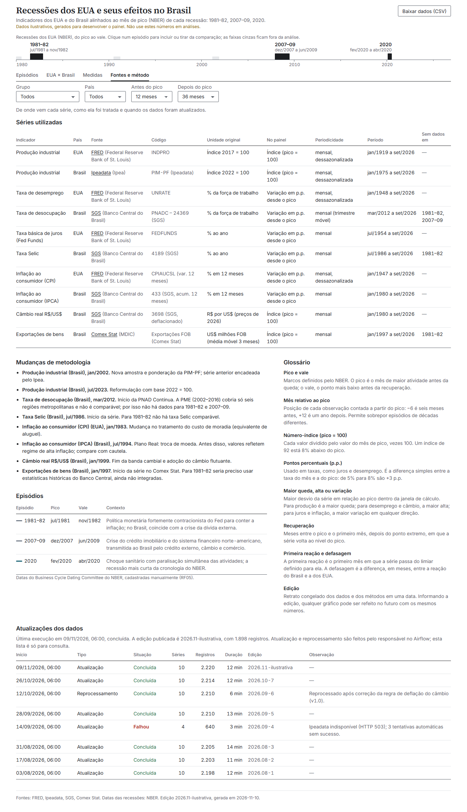

# Painel de recessões — rascunho

## Como abrir

1. Instale [Node.js](https://nodejs.org/) (que inclui o npm).
2. No terminal, dentro desta pasta, execute:

   ```bash
   npm install
   npm run dev
   ```

3. Abra no navegador o endereço local mostrado no terminal, geralmente `http://localhost:5173`.

Os dados em `public/data/` são ilustrativos e servem para desenvolver e visualizar o painel. Não use os números em análises ou no TCC como resultados oficiais.

## Telas do painel

Capturas em 1366 px de largura, incluindo o conteúdo completo de cada aba.

### Episódios



### EUA × Brasil



### Medidas



### Fontes e método


